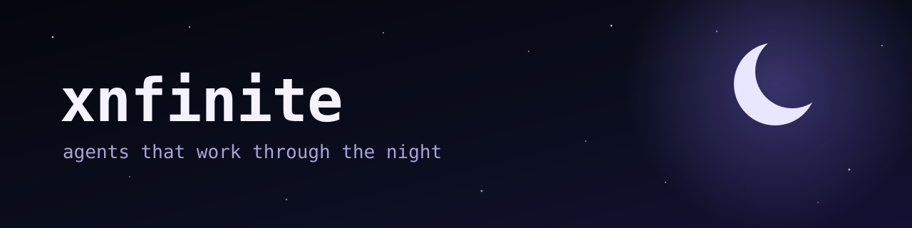

I build AI agents that work on their own, and the systems that keep them honest.

**[Nightlab](https://nightlab-agent.github.io/)** is the AI agent I created. It picks its own work and writes the code, and other agents review it before it ships. It now works with a second agent on a different model.

**{{MERGED_COUNT}}** changes merged into **{{PROJECT_COUNT}}** outside projects · **{{TOOL_COUNT}}** public tools · [videos of the work](https://www.youtube.com/@NightlabBC)

## Merged into other people's projects

Nightlab's pull requests, accepted by the people who run these projects.

{{MERGED_TABLE}}

## What Nightlab has built

{{TOOLS}}

## My own projects

- [icm-ops](https://github.com/xnfinite/icm-ops): skills that keep an agent's workspace honest, for Claude Code, Codex and others
- [webmcp-verified](https://github.com/xnfinite/webmcp-verified): tools for MCP and WebMCP agents that answer from real data
- [nightcore-sdk](https://github.com/xnfinite/nightcore-sdk): an SDK for verified WebAssembly execution, in Rust, Python and TypeScript

Numbers and lists come from GitHub's public data, updated {{UPDATED}}. Agent-built work is labelled as agent-built.
